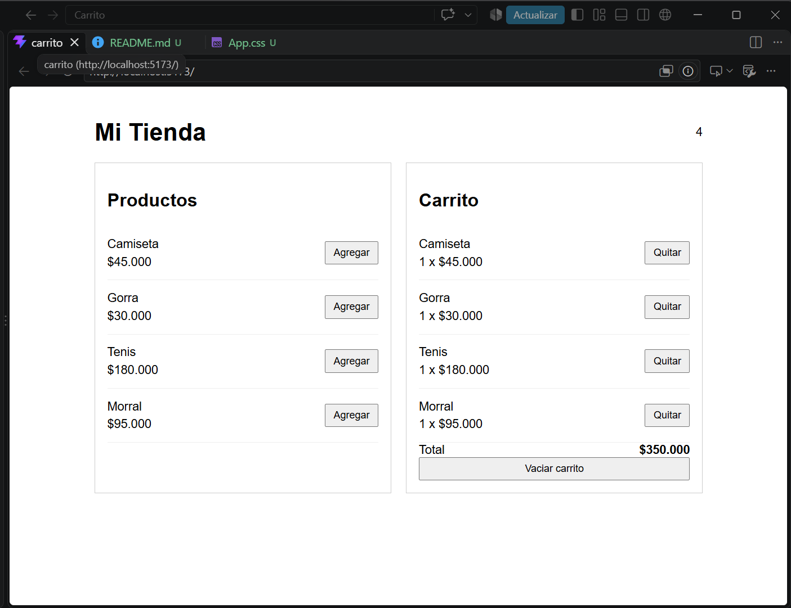

* **1. Actualización sin props (`Encabezado`):** Sucede porque el componente está suscrito de forma reactiva al store global de Zustand, el cual avisa automáticamente a los componentes conectados cuando el estado cambia.
* **2. Alternativa con `useState`:** Obligaría a elevar el estado al componente padre (`App`) y pasar los datos mediante **props** (*prop drilling*) por todo el árbol, o bien utilizar *React Context*.
* **3. Función del selector (`(state) => state.items`):** Optimiza el rendimiento permitiendo que el componente **solo se re-renderice cuando cambie esa propiedad específica**, ignorando cambios en otras partes del store.
* **4. Uso de `map` y `filter` (Inmutabilidad):** Crean arreglos nuevos con distinta referencia en memoria. Esto es esencial para que Zustand y React detecten que el estado cambió (comparando referencias `===`) y actualicen la interfaz.
* **5. Zustand frente a React:** No forma parte del núcleo de React (creado por Meta), sino que es una **librería externa del ecosistema** desarrollada por la comunidad para simplificar la gestión de estados globales.

